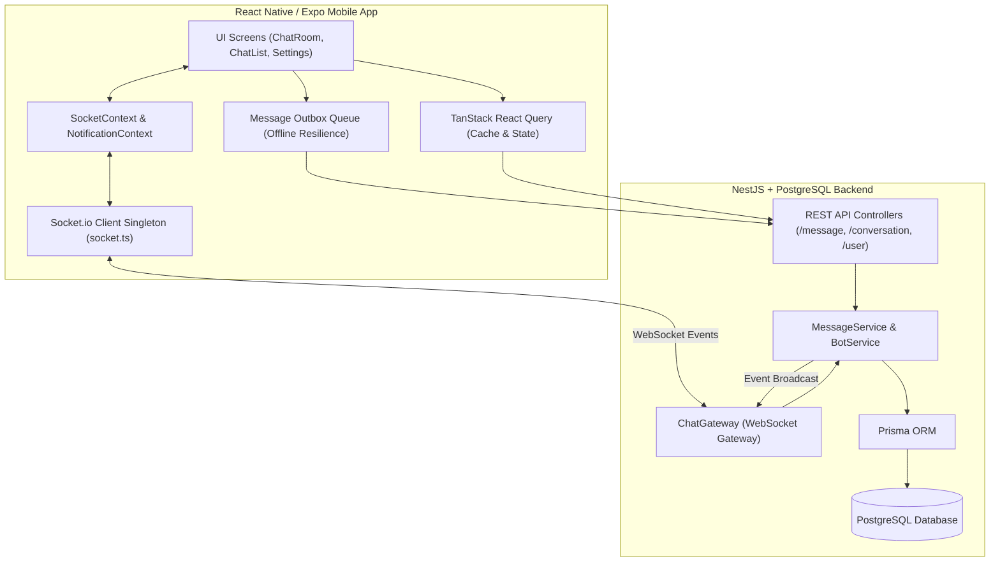
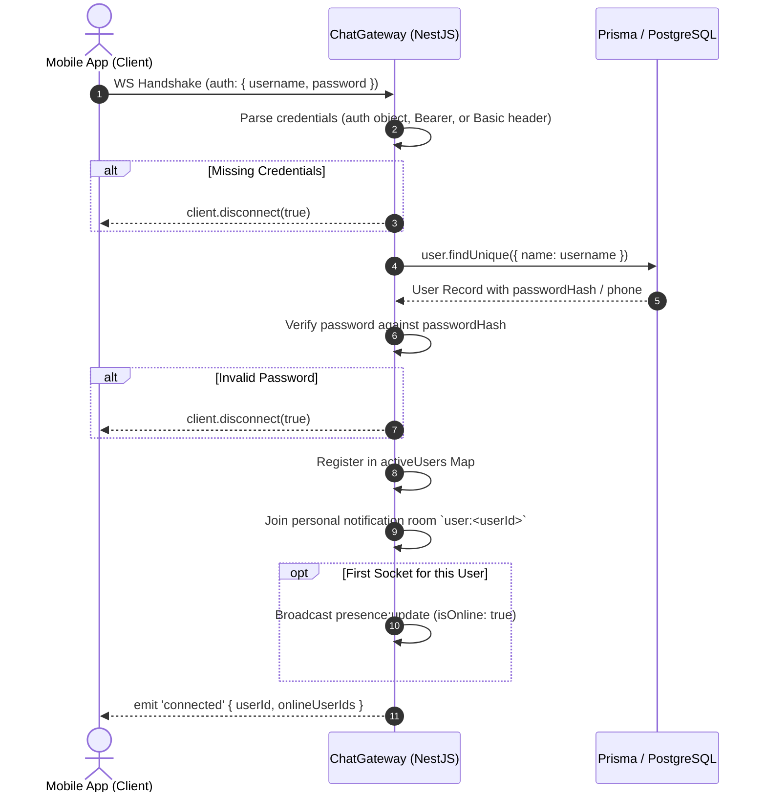
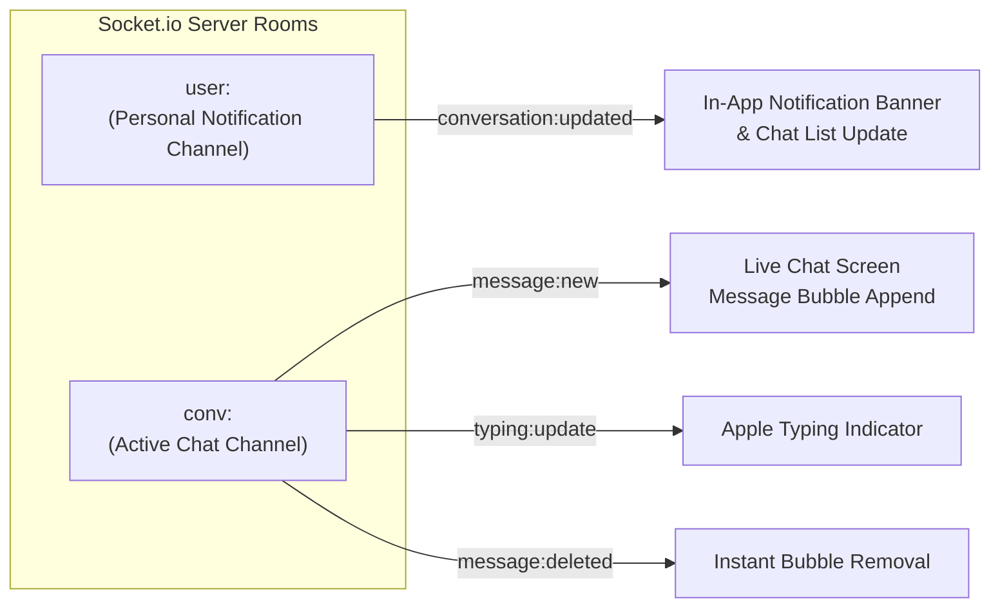
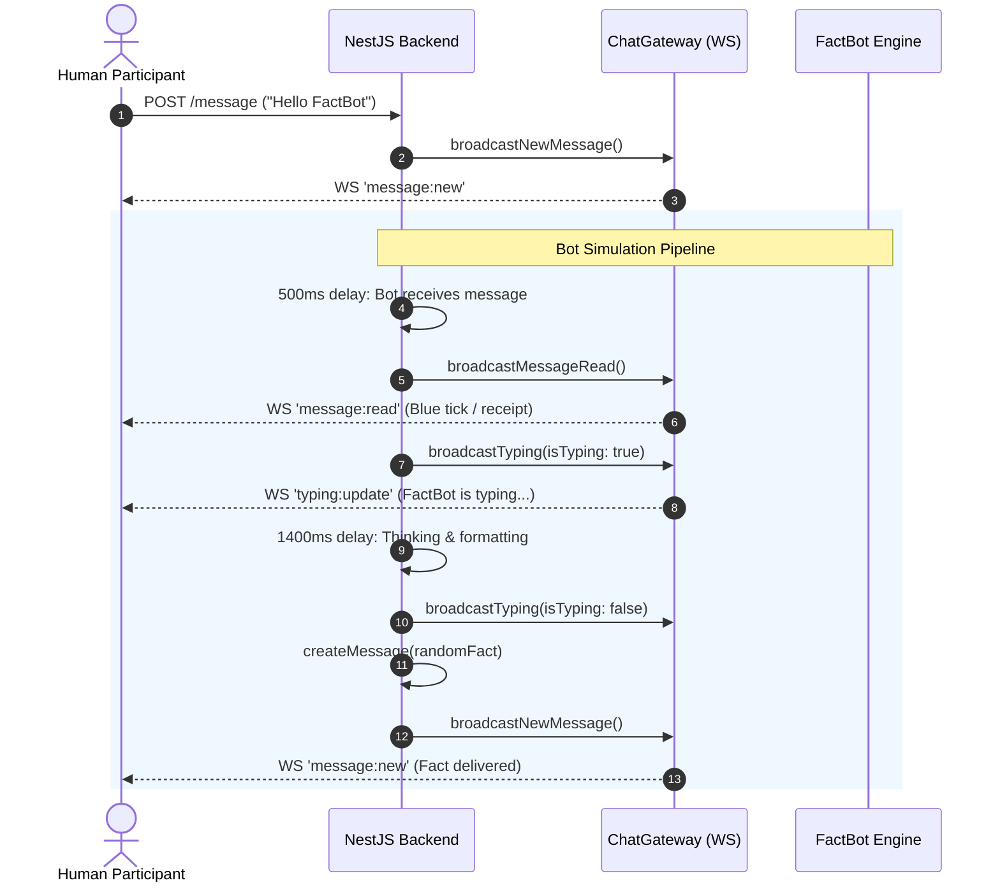
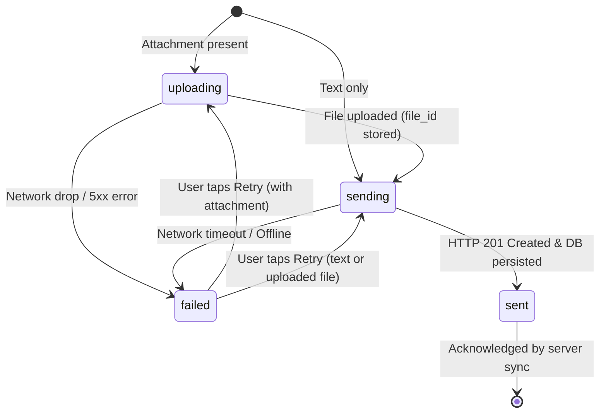

# Chat Application Architecture & Engineering Specifications

This document provides a comprehensive architectural breakdown of the advanced features engineered on top of the original prototype, with special focus on the **Real-Time WebSocket Infrastructure**, **Message Outbox & Resilience Engine**, **Notifications Pipeline**, and **Design System**.

---

## 1. High-Level System Architecture

The application adopts a decoupled, event-driven client-server architecture:
- **Client (Frontend)**: React Native / Expo application utilizing TanStack React Query v5 for caching, Socket.io for bidirectional events, and a persistent Message Outbox.
- **Server (Backend)**: NestJS micro-framework backed by PostgreSQL and Prisma ORM, exposing a REST API alongside a Socket.io WebSocket Gateway.



---

## 2. In-Depth: Real-Time WebSocket Infrastructure

The WebSocket implementation enables real-time message streaming, typing awareness, user presence, read receipts, and live message deletion without polling.

### 2.1 Connection Lifecycle & Authentication Handshake

Unlike insecure implementations, WebSockets in this app are strictly authenticated during the handshake before a socket is permitted to connect:



#### Code Implementation: `backend/src/message/chat.gateway.ts`
```typescript
async handleConnection(client: Socket) {
  let username = client.handshake.auth?.username;
  let password = client.handshake.auth?.password;
  // Fallbacks: reads from auth.token or handshake headers if needed...
  
  const user = await this.prisma.user.findUnique({
    where: { name: username },
    select: { id: true, name: true, passwordHash: true, phone: true },
  });

  if (!user || !(await verifyPassword(password, user.passwordHash))) {
    client.disconnect(true);
    return;
  }

  client.data.user = { id: user.id, name: user.name };

  // Track multi-device active sockets per user
  let sockets = this.activeUsers.get(user.id);
  const isFirstConnection = !sockets || sockets.size === 0;
  if (!sockets) {
    sockets = new Set();
    this.activeUsers.set(user.id, sockets);
  }
  sockets.add(client.id);

  // Join personal room for conversation list & notification fan-out
  client.join(`user:${user.id}`);

  // Broadcast presence change to all clients
  if (isFirstConnection) {
    this.server.emit('presence:update', { userId: user.id, isOnline: true });
  }

  // Acknowledge connection and hydrate online users list
  client.emit('connected', {
    userId: user.id,
    onlineUserIds: Array.from(this.activeUsers.keys()),
  });
}
```

---

### 2.2 Dual-Tier Room Partitioning & Security

To prevent unauthorized snooping, WebSockets use a dual-tier room design:

1. **User Room (`user:<userId>`)**:
   - Every client automatically joins their personal room upon connection.
   - Receives `conversation:updated` events whenever any conversation the user belongs to receives a new message, triggering background cache invalidation and top in-app banners.
2. **Conversation Room (`conv:<conversationId>`)**:
   - Clients join this room only when entering `ChatRoomScreen`.
   - **Security Enforcement**: The server queries Prisma to ensure the user is an authorized member in `conversation.participants_ids`. Unauthorized join requests are rejected.
   - Emits in-room events: `message:new`, `message:deleted`, `typing:update`, and `message:read`.



---

### 2.3 Real-Time Event Catalog

| Event Name | Direction | Payload | Description |
| :--- | :--- | :--- | :--- |
| `room:join` | Client -> Server | `{ conversationId }` | Validates membership and adds socket to `conv:<conversationId>`. |
| `room:leave` | Client -> Server | `{ conversationId }` | Leaves `conv:<conversationId>` when leaving screen. |
| `typing:start` | Client -> Server | `{ conversationId }` | Emits start typing to room peers. |
| `typing:stop` | Client -> Server | `{ conversationId }` | Emits stop typing to room peers. |
| `typing:update` | Server -> Client | `{ conversationId, userId, userName, isTyping }` | Bounces typing indicator to room participants. |
| `message:new` | Server -> Client | `{ conversationId, message }` | Delivers confirmed database message to active room. |
| `message:read` | Bidirectional | `{ conversationId, messageId, userId }` | Read receipts synchronization. |
| `message:deleted`| Server -> Client | `{ conversationId, messageId }` | Removes deleted message across all devices in room. |
| `presence:update`| Server -> Client | `{ userId, isOnline }` | Broadcasts online/offline status changes. |
| `conversation:updated` | Server -> Client | `{ conversationId, conversationName, senderName, lastMessage }` | Global alert to user room for notifications & list order. |

---

### 2.4 Typing Indicator Lifecycle & Auto-Clearing

To guarantee typing bubbles do not get stuck when a sender disconnects or switches apps without triggering `typing:stop`, a dual-guard mechanism is implemented:
- **Server-side Room Check**: Sockets cannot emit typing events unless they are verified members of `conv:<conversationId>`.
- **Client-side Auto-Expiry (`SocketContext.js`)**: A 4-second safety timer automatically clears the typing indicator if no new typing pulse is received.

```javascript
// src/context/SocketContext.js
const handleTypingUpdate = (data) => {
  const { conversationId, userId, userName, isTyping } = data;

  const existingTimer = typingTimersRef.current.get(conversationId);
  if (existingTimer) {
    clearTimeout(existingTimer);
    typingTimersRef.current.delete(conversationId);
  }

  setTypingUsers((prev) => {
    if (!isTyping) {
      const next = { ...prev };
      delete next[conversationId];
      return next;
    }

    // Auto-clear typing indicator after 4 seconds of silence
    const timer = setTimeout(() => {
      setTypingUsers((current) => {
        const copy = { ...current };
        delete copy[conversationId];
        return copy;
      });
    }, 4000);
    typingTimersRef.current.set(conversationId, timer);

    return { ...prev, [conversationId]: { userId, userName } };
  });
};
```

---

### 2.5 Automated FactBot Integration with WebSockets

The application features an interactive companion bot (`FactBot`) implemented in `backend/src/bot/` and `backend/src/message/message.service.ts`. FactBot participates naturally over WebSockets by simulating human behavior:



---

## 3. Resilient Offline Message Outbox

In mobile environments with intermittent connectivity, sending messages directly through raw `fetch()` causes lost data and broken states. The application implements an offline-first **Message Outbox** pattern ([src/utils/messageOutbox.ts](file:///Users/akshith/Desktop/ChatApp_React_Native/src/utils/messageOutbox.ts)).

### 3.1 State Machine

Each outgoing message passes through distinct local states:


### 3.2 Key Resiliency Guarantees
1. **Instant Optimistic UI**: The message bubble is rendered immediately with a temporary client ID (`local-<timestamp>-<seq>`), showing a clock/spinner icon.
2. **Atomic Attachment Decoupling**: If a message has an image, the file is uploaded first. If uploading succeeds but sending the message fails, the generated `file_id` is cached in the outbox payload. Tapping "Retry" sends the message without re-uploading the file.
3. **Merge & Chronological Deduplication**: `mergeChatMessages()` in `src/utils/messageOutbox.ts` merges server messages and outgoing outbox items into a unified sorted sequence using `createdAt` timestamps, eliminating duplicates.

---

## 4. Notifications & In-App Banners Pipeline

The notification architecture delivers alerts whether the app is active or minimized:

```mermaid
flowchart TD
    WS["WebSocket Gateway"] -->|conversation:updated| NC["NotificationContext.js"]
    NC --> CheckActive{"Is activeConversationId == conversationId?"}
    CheckActive -->|Yes (User already in room)| Discard["Suppress Notification"]
    CheckActive -->|No| CheckSender{"Is senderId == currentUserId?"}
    CheckSender -->|Yes| Discard
    CheckSender -->|No| FanOut["Trigger Dual Notifications"]
    
    FanOut --> System["expo-notifications\n(System Heads-Up / Sound)"]
    FanOut --> Banner["InAppNotificationBanner.js\n(Floating Interactive Top Pill)"]
    
    Banner -->|User Taps Banner| Nav["navigateToChatRoom(conversationId)"]
    System -->|User Taps System Tray| Nav
```

---

## 5. Apple Messages Design System & Theming

The application avoids default React Native UI controls in favor of a cohesive Apple-style design system:

- **Tokens & Theme Provider (`src/theme/colors.ts`, `src/context/ThemeContext.js`)**: Provides semantic tokens for light and dark palettes (`background`, `surface`, `primary`, `bubbleSender`, `bubbleReceiver`, `separator`).
- **Smooth Interactive Touch (`src/components/AnimatedPressable.js`)**: Wraps interactive elements with `react-native-reanimated` spring physics for native micro-haptics and shrink-on-press feedback.
- **Dynamic Avatars (`src/components/AppleAvatar.js`)**: Computes deterministic user initials and subtle color rings with an active green presence pip based on WebSocket presence status.
- **Accessibility & Motion Budgeting (`src/theme/motion.ts`)**: Supports reduced motion mode, instantly disabling physics loops for users sensitive to motion.

---

## 6. Directory Structure of Enhanced Architecture

```
ChatApp_React_Native/
├── backend/                         # Complete NestJS Server
│   ├── src/
│   │   ├── auth/                    # Basic Auth Guards & validation
│   │   ├── bot/                     # FactBot simulated human intelligence
│   │   ├── conversation/            # Conversation membership & room logic
│   │   ├── file/                    # File upload & download endpoints
│   │   ├── message/
│   │   │   ├── chat.gateway.ts      # WebSocket Gateway (Socket.io)
│   │   │   └── message.service.ts   # Message creation & WebSocket event dispatch
│   │   └── prisma/                  # PostgreSQL schema & client
│   └── test/                        # Backend integration tests
├── src/
│   ├── api/
│   │   ├── socket.ts                # Socket.io singleton client
│   │   ├── types.ts                 # TypeScript data contracts
│   │   └── hooks.ts                 # TanStack React Query hooks
│   ├── components/
│   │   ├── AppleAvatar.js           # Apple style avatars with presence
│   │   ├── AppleTypingIndicator.js  # Bouncing 3-dot typing bubble
│   │   └── InAppNotificationBanner.js # Animated drop-down banner
│   ├── context/
│   │   ├── AuthContext.js           # Multi-user login & credential storage
│   │   ├── SocketContext.js         # Real-time WebSocket subscriptions
│   │   ├── NotificationContext.js   # Local & in-app alerts
│   │   ├── MessageOutboxContext.js  # Offline sending queue
│   │   └── ThemeContext.js          # Dark/Light mode engine
│   ├── screens/
│   │   ├── AuthScreen.js            # User login & endpoint configuration
│   │   ├── ChatRoomScreen.js        # Message stream, typing & attachments
│   │   ├── ChatListScreen.js        # Active conversations & unread badges
│   │   └── SettingsScreen.js        # Server URL, theme, & motion preferences
│   └── utils/
│       ├── messageOutbox.ts         # Outbox state machine & deduplication
│       └── messageMotion.ts         # Animation configs & spring physics
└── tests/                           # Node.js automated test suites
```
